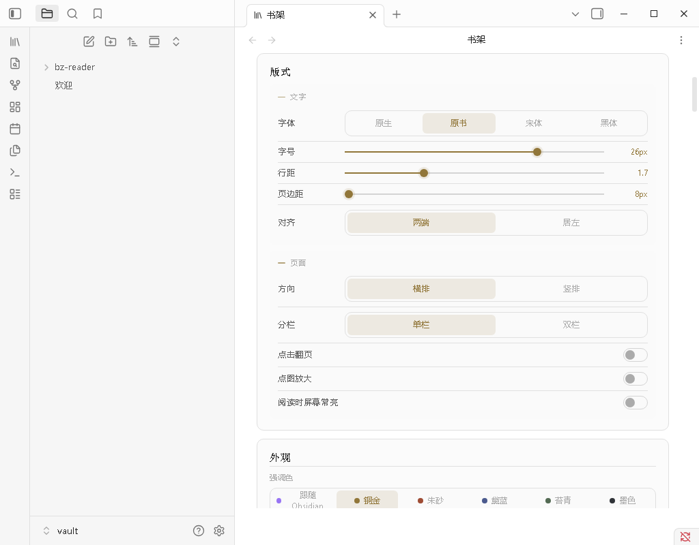
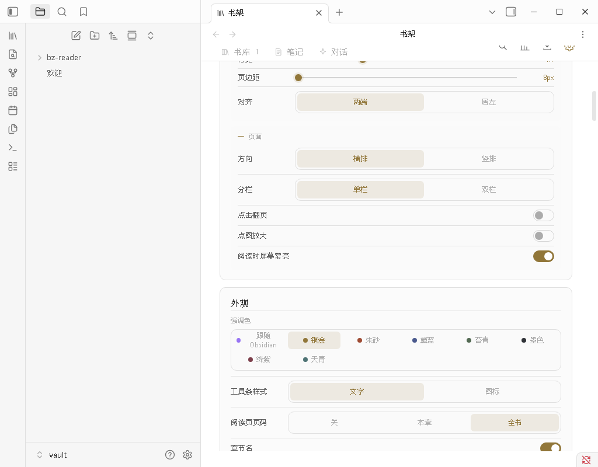
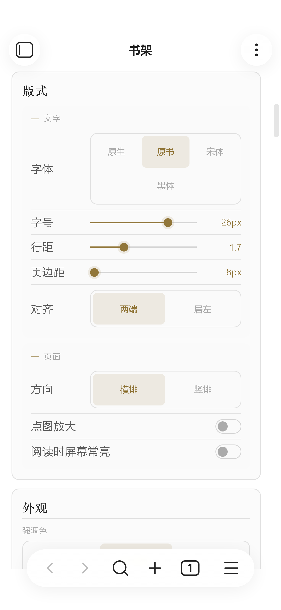
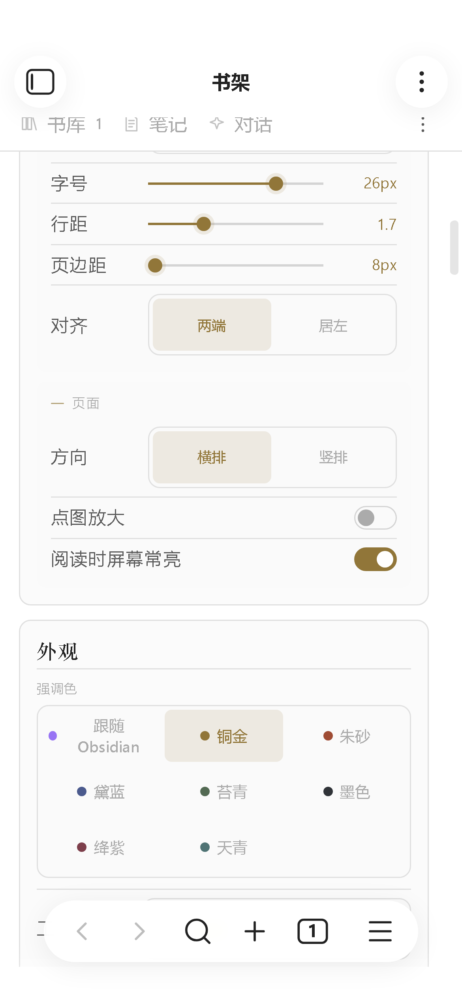
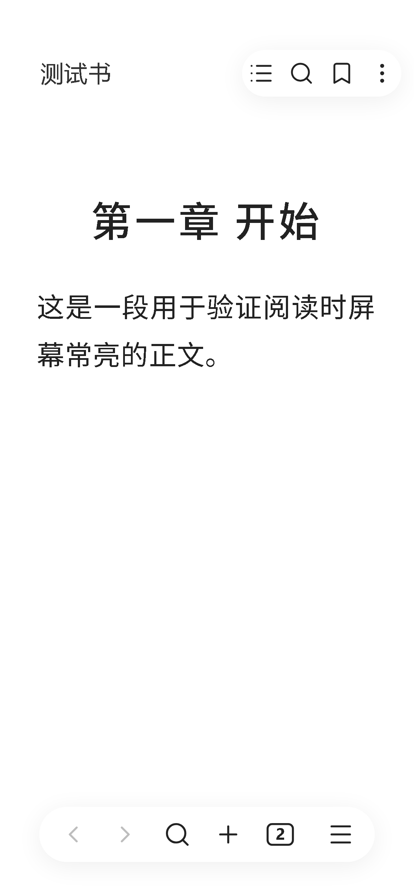

# 真机验证 · 阅读时屏幕常亮通用化（2026-11-24）

## 范围

把「阅读时屏幕常亮」从 manga 偏好抽到通用 `ReaderPrefs` 顶层，所有书（EPUB / PDF / 漫画 / 剪藏）共用；权益给基础版，对照表 / README / 商店稿同批更新。

## 环境

| 项 | 值 |
|---|---|
| 提交 | `eaefbe6` (master) |
| 构建 | worktree `fix/keepawake-reapply`，`BZ_READER_VAULT=test` 落测试库 `E:/Obsidian/bz review` |
| 真机实例 | obs-test `bzr-keepawake2`，桌面 1024×800、移动 390×844@3x（iPhone 模拟） |
| 门禁 | tsc 绿；vitest 4340 通过 / 2 失败（`revoked.test.ts` 基线失败，master 未改代码时同样失败）；esbuild 绿 |
| lint | 10 个存量 error（`ai.ts` / `manga/view.ts` 的 style 赋值），master 基线同样 10 个，本次未新增 |

## 验证项与证据

### 1. 桌面端：设置页开关存在、默认关、可切换

*设置 → 版式 → 页面子块出现「阅读时屏幕常亮」开关，默认关。*

*点击后开关由灰变铜色，运行时 `currentPrefs().keepAwake === true`。*

### 2. 移动端：开关可见、可点、不被底栏遮挡

*版式 → 页面子块中开关位于「点图放大」之后，布局正常。*

*触摸点击后开关变亮，运行时值 true，底栏未遮挡。*

### 3. 开书后 wake lock 生效、阅读页无报错

*以 txt 书打开阅读视图，正文与底栏正常，无 console error。运行时读取阅读视图 `wakeLock.active === true`、`prefs.keepAwake === true`、`navigator.wakeLock` 可用——开书时确实申请了屏幕锁。*

### 4. 过程中发现并修复的问题

真机首轮发现：开关渲染出来了但点击无反应。根因是设置页开关走 `preftoggle` 逐 key 白名单，而 `actions.ts` 的 `preftoggle` 分支漏了 `keepAwake`（最初误加在 `setPref` 的 `setpref` 分支，路径不对）。已在 `preftoggle` 分支补上，并把渲染与白名单成对关系写成永久回归断言（`tests/keep-awake.test.ts`）。修复后重新构建 + 全新实例验证通过。

## 结论

改动路径在真实 Obsidian 桌面与移动端均走通：开关可见、可切换、开书后常亮生效、关书释放（代码路径 + 单元测试覆盖）。P0/P1 全部通过。
